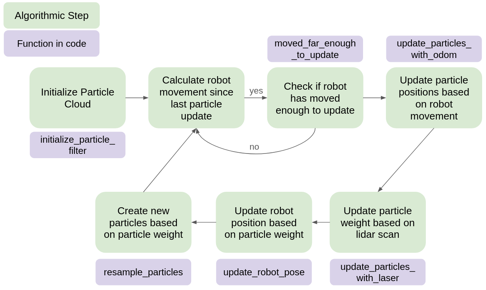
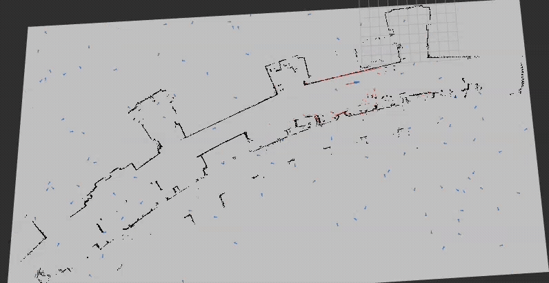

# State Estimation and Localization Project
Ellie Kung and Wynona Brinkmann

For Olin ENGR3590 Computational Introduction to Robotics

## Project Overview
For this project, we created a particle filter in ROS2 that takes a given map and uses the robot’s lidar scan and odometry readings to localize where the robot is on the map. 

While the main goal was to create a working particle filter, we also learned how to work with an existing code base, tune for accuracy and computational efficiency, and strategies for debugging and writing unit tests.

## Approach to State Estimation
### Algorithm Overview
For this project, we were given starter code which included some helper functions and the skeleton of the particle filter. The main logic for the particle filter was in the ParticleFilter class, which had a run_loop function that executed the code. The main steps of that function are shown in the system diagram below:

The core of the logic revolves around the middle four steps - updating the particles with odometry and laser scan, robot pose, and resampling. These steps are described in greater detail below.

To start, we initialize the particles in the particle filter. We randomly distributed them throughout the bounding box and assigned all equal weights. With the particles initialized and the robot moving we could start on the first step.

#### `update_particles_with_odom`()

Motion update. This function calculates the difference in the robots position (given in the odom frame), converts that change to the world frame, and applies that change to every particle to update the position of the particle. In order to account for drift and other inconsistencies, and to make sure particles don’t converge, we add noise to every particle position. This is done through a normal distribution, centered at the expected position, and with a standard deviation of the sum of some variable and the absolute value of distance traveled, so that more travel gives more deviation.

Once we update each particle’s location, we also check to see if it is still in the bounding box. If not, we regenerated them to a random location within the bounding box. This no longer majorly affects our code as the probabilities of a robot being outside the box is low. However, during the initial stages of our design the weighting was not yet set up correctly and as a result the particles would cluster and be outside the bounding box. Hence, not contributing to the prediction of the robot. 

#### `update_particles_with_laser()`

Observation update. This function updates each particle’s weight based on the laser scan. The first thing it does is filter out any unwanted data from the data scan. This included NaN and inf, where inf was extracted as it made the data more complicated to process. Once the bad values are filtered out, the code parses through each particle to determine its weight. Each particle has some number of valid laser scans which are parsed to compare to the likelihood field. 

Every third scan (instead of every scan to save on computation time) is used to compare to the occupancy field. This is done by finding the position of the obstacle (hit_x, hit_y) in the world frame using the position of the particle as the robot position, and then using the helper function get_closest_obstacle_distance (hit_x, hit_y). This returns the difference of the obstacle and the laser scan. We can then use the gaussian probability density function (pdf) to determine how likely the obstacle distance is correct, creating a likelihood field using a `sigma_hit` value of 0.3, where `sigma_hit` is the variance or confidence bounds we have of that distance difference.  Because the gaussian pdf uses an exponential, and in order to find the total probability you have to multiply each independent probability, we take advantage of the log rule ln(a*b) = ln(a) + ln(b) to keep the probability in its log form so that we can add large numbers instead of multiplying lots of small numbers to get an even smaller number. This gives us a log weight for every scan which we add up to find the log weight for every particle. 

Another notable thing we decided to do in this function is to add a cap on the difference. This is so that one large difference does not overpower all the smaller differences which are more important because we want the scans to be as close to the walls as possible. We chose a value of 1 meter, so any scan and obstacle distance greater than 1 meter only uses the value of 1 meter. 

#### `update_robot_pose()`

To update the robot pose, we first make sure all the weights are normalized. This is done by the function `normalize_particles()`. Because we set all the weights in their log form, we need to normalize back so that they all equal one. To do this, we find the raw weight, by subtracting the largest `log_weight` and the exponentiating so that at least one particle will have a `raw_weight` of 0 giving us 1 when exponentiated. Then to normalize, we find the total weight of all the particles and divide each particle’s raw weight by the total.

Once the particles are normalized, we can guess the robot’s pose. Initially, we thought that we should choose the particle with the largest weight based on itself and the particles around it. This led us to adding up the particle’s weight and the weight of the particles within some radius around it. Ultimately, this did not work as the random particles would never be close to the robot's pose, even with a higher probability as it could not compete with a cluster of particles that had a slightly higher probability. To combat this, we decided to set the robot pose to the particle with the largest weight. 

#### `resample_particles()`

With all the new weights, we can resample the particles. To make sure the particles don’t all converge, we added a random injection. This takes about 12.5% of our particles and sets their coordinates to a uniformly random spot within the bounding box. The rest of the particles are set in a new cloud through a helper function: `draw_random_sample()` which utilizes the weights of each particle to establish the frequency of which that particle appears in the new cloud.

### Implementation and Experimental Design
At first, we tried to solely use the closest obstacle distance to try and have the particle converge to a spot. However, this ignored the heading of the robot and did not converge to a location because there was an abundance of choice for the closest obstacle to be the same distance but a different wall. This is when we decided to implement the likelihood field, taking into account multiple scan points and adding the gaussian pdf. 

Another design choice we made was using the log weight instead of a normalized weight when adding all the scans together and also adding a cap value to the scan data. We had a lot of nan problems, leading us to believe that the numbers we were multiplying together were just getting too small, so we decided to switch to the log weights. We also realized that one bad reading would disqualify the particle from the particle cloud, so the end cap helped protect against any noisy readings. 

One final design choice we had was deciding the values of our various standard deviations (sigma) and random injection values. While these were experimentally defined, a lot of the values make sense. For the hit box, we used a larger sigma (0.3) because the laser scans were really jumpy and moved around quite a bit. But for the particle locations, we used a much smaller standard deviation (0.01 + 0.05*(delta), delta being the difference in pose) because the odometry drift is much less noisy and it is based on the difference in pose. For the random injections, we started out with 5% and kept increasing until the particles were able to converge to the correct location (ended up with 12.5%). 

Particle filter implementation with 12.5 % random injection

 

Particle filter implementation with 10% random injection
 

### Unit Test Design and Integration
For the start of this project testing was primarily conducted through print statements. This is how errors around variable set up - like unwanted arrays - were caught and debugged. These also allowed for particle positions to be printed, however, unit tests were more efficient at checking that particles remained within bounds. It was also helpful in checking that our logic for randomization of particles did not add or delete any particles, ensuring that they stayed consistent throughout. 

Another important test was checking that the weights truly equal 1. While we had used print statements to ensure the code was running and updating, the unit test revealed an error with how we set up variable ‘p’ inside of our normalize_particles function, which we were then able to fix. The code had been running, so without checking the logic using a unit test, we likely would not have found this error until much later. This also became a key learning that setting up unit tests earlier would likely have helped us throughout the debugging stages.

Another test was implemented to check the translation of particles as the robot moved to ensure the headings of individual particles were consistent and performed as expected. This was important as early runs of our particle filter displayed issues and by creating a unit test to test our logic we ensured that the particle functioned as expected.

Lastly, through our print statements we had seen that sometimes our `p.log_weight` variable will show NaN and we decided to write a unit test for this. This test currently fails, however the fix would revolve around checking for negatives and small values. Currently the code does localize and the fix has been overcompensating with particle count and randomization. However, future work would include ensuring this unit test passes.

Of note, all unit tests were written to bypass the `init` call so that the functions in `pf.py` could be tested without live nodes. This was done using `MagicMock()` which allows the substitution of real objects and keeps track of interactions, essentially verifying that a parameter reads correctly.

To run the unit tests in terminal ensure the file directory is set to the folder where `test_pf.py` and `pf.py` are located and run `python3 -m pytest -v test_pf.py`.

### Testing the System
The testing of this system was completed in various stages and ways. The previous section outlines the use of both print statements and unit tests for experiential testing. However, the overall system was tested in simulation. By running a provided bagfile (macfirst_floor_take_1) which contains a recorded neato robot run and our code contained in `pf.py` the localization could be visualized in rviz2. Running this in simulation allowed us to watch the behaviors our particles exhibited, and compare that to our expectations. This became more important when we began tuning our parameters and needed to understand the effect certain values had on performance. Bagfiles of the runs were created at incremental steps in the coding process and outlined below:

- `particle_localization_initial_recorded_test` - This bag has the implementation version where we first got log weights to work. However, the particles converge at different locations and the robot is not in the correct pose because we are taking into account the neighboring particles by adding their probability (in hindsight we should have multiplied the probability of each particle instead). 
- `particle_localization_second_recorded_test` - This bag file has the implementation version where we started to change the sigma values and other relevant variables. We also got rid of the cluster probabilities being accounted for, focusing on the particle with the largest weight.
final_take_random_injection_10percent - This bag file shows our final implementation and sigma values, changing the random injection percentage to 10. 
- 'final_take_random_injection_12percent' - This bag file shows our final implementation and sigma values, changing random injection percentage to 12.5. This ended up working much better and converging faster than the 10% version. 

Bagfiles can be found within the bags folder in the overall repo `robot_localization/bags`.

## Challenges and Next Steps
Describe any challenges you encountered along the way and steps you took to address them. Describe any improvements you would make if you had more time.

**Challenges and Fixes:** The majority of challenges have been noted in previous sections, however another one of note was that for a long time we were incorrectly rewarding particles by providing an error of 0 to those that had a distance to the closest obstacle over 1m. Fixing this was incremental in allowing our filter to function correctly. By drawing our attention to this part of the code we also tweaked the value for the cap on the distance where any delta (of the obstacle location in world frame as related to the particle and robot being in the same location) being too large means a particle does not get kept.

**Possible Improvements:** Our initial particle cloud does not take into account an initial guess pose. This is not a big problem for this map because it is fairly small, but would definitely be an improvement for future implementations. 

## Learning Objectives and Final Takeaways
**Collective Takeaways and Future Work:**
As we are wrapping up this project a step we would like to take, that we did not have time to do, is testing our particle filter on a different map. This would allow us to see if the variable tuning we performed translates to other environments, or if other parts of the code might break. Another next step would include looking at why the clustering is not as robust. In part this is because of the high randomization, however this could likely benefit from having the randomized particles insert within certain radii of highly weighted particles, with a select few still being truly random across the map. This would allow for faster clustering around weighted particles, while still keeping some random particles. A likely bottleneck with this approach would be if it centers around one spot too quickly.

**Ellie Learning Objectives:** Through this project, I wanted to learn how a particle filter works conceptually and mathematically and then be able to execute the code. Having the skeleton code helped a lot because I was able to contribute to a code base, allowing me to spend more time understanding the math and how it all worked together.

**Wynona Learning Objectives:** Through this project I wanted to gain familiarity reading through code that had been written, understanding it, and then contributing. I think especially the first part (reading code) has been helpful in my familiarity with both coding practices and different ways of setting up functions. Being able to parse through the helper functions and identify which would be of use and where solidified my learnings throughout this project. Another learning/takeaway in this project was reviewing unit tests, their purpose, and implementing them. I think overall, I saw their value in this project a lot more than in the limited previous ones I have had to use them in and wish we had implemented more and also sooner. 

## How To Run
1. Download or clone our repository in your ROS workspace: `ros2_ws/src/`

2. Build and compile the packages:

        colcon build --symlink-install

3. Source the `install.bash` script:

        source ~/ros2_ws/install/setup.bash

4. Launch rviz2 and pass configuration file:

         rviz2 -d ~/ros2_ws/src/robot_localization/rviz/turtlebot_bag_files.rviz

5. Launch particle filter and map, changing `username` and making sure the file path to the map is correct:

        ros2 launch robot_localization test_pf.py map_yaml:=/home/username/ros2_ws/src/robot_localization/maps/mac_1st_floor_final.yaml

6. Play the bag file containing the robot's motion and laser scan data, changing `username` and making sure the file path to the bag file is correct:

        ros2 launch robot_localization test_pf.py map_yaml:=/home/username/ros2_ws/src/robot_localization/maps/mac_1st_floor_final.yaml

    Alternatively, run a teleop on a physical robot and move the robot around and gather laser scan data from there. 

